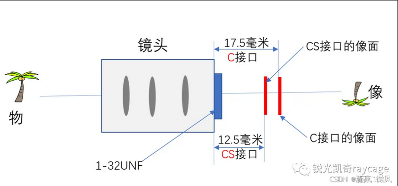
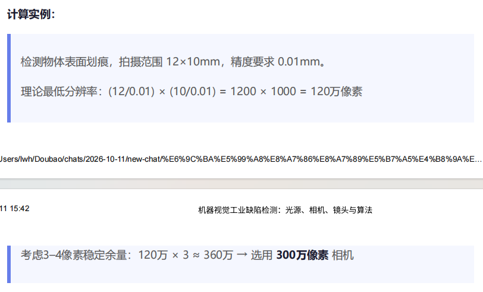
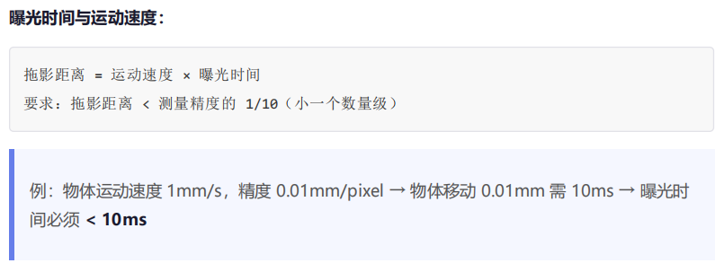
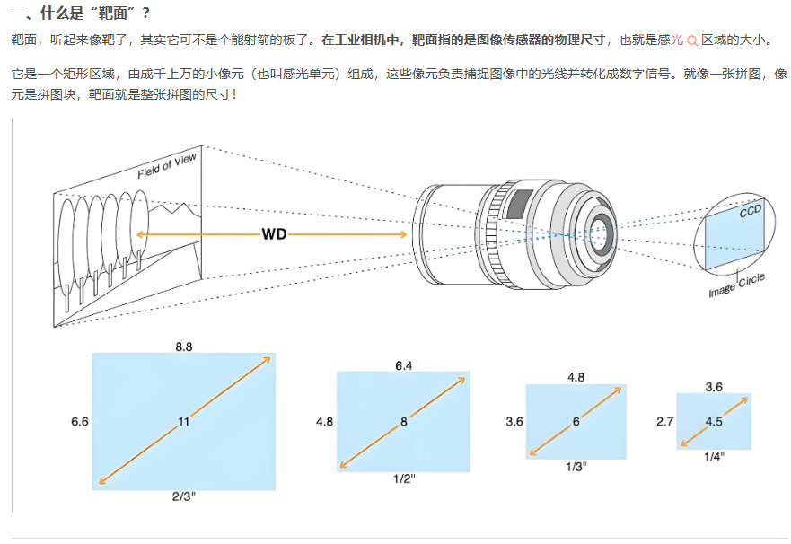
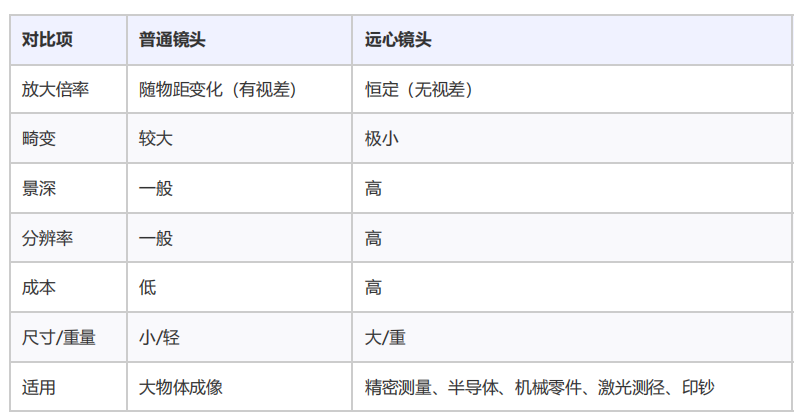
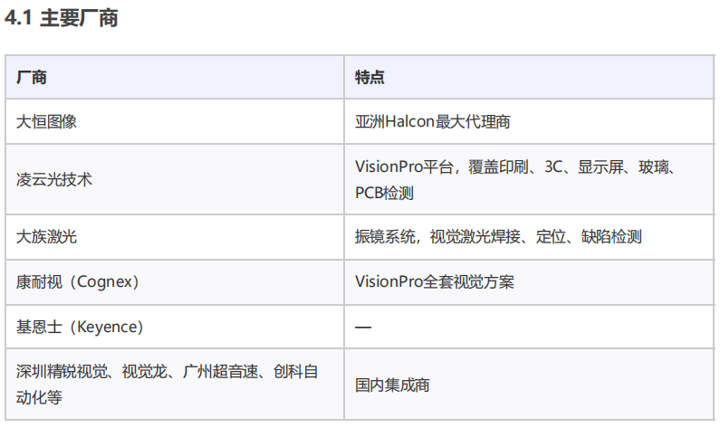
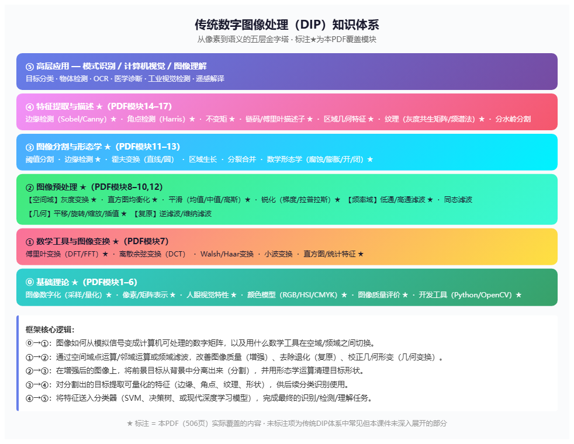

# 3、机器视觉主要的应用方向‑机器视觉工业缺陷检测（光源，相机，镜头，算法）
3.1 定位、测量、检测、识别

3.2 应用领域

​	工业、医学、遥感、军事/公安、通信/传媒

3.3 景深

​	理论上，只有对焦点处最清晰，但由于镜头特性和拍摄条件，焦点前后一定距离内的景物也能清晰呈现，这段范围就是景深。

​	光圈大小：光圈越小，景深越大；光圈越大，景深越小。

​	焦距：长焦镜头景深较浅，广角镜头景深较深。

​	对焦距离：拍摄距离越近，景深越浅；距离越远，景深越深。

3.4 机器视觉系统组成

​	图像获取相关硬件：相机、镜头、光源、图像采集卡

​	图像处理分析：图像预处理、基于图像信息提取做语义分析

​	数据管理与人机交互：产品合格/不合格判定，对接第三方系统（如PLC）

​	一般机器视觉系统由相机、镜头、光源、运动系统、视觉软件算法构成。

3.5 硬件选型‑光源

​	光源类型

​		LED灯

​		荧光灯

​	照射方式

​		背光

​		透光

​		结构光

​		频闪光

​	光源形态

​		同轴光源

​			适用于平面物体

​		低角度

​		高角度

​		环形光源

​	光源选择原则-颜色与波长

​		颜色与颜色互补，同色系光会变得更亮，互补系光会变得更暗

​		波长越长，穿透能力越强

​		波长越短，扩散能力越强

​	光源选择原则-形状与尺寸

​		与被测物体形状相同的光源

​		光源尺寸应略大于视野

​	光源选择原则-是否使用漫射光源

​		被测物表面反光

3.6 硬件选型‑相机

​	相机分类

​		黑白相机、彩色相机

​		线阵相机（黑白/3Line彩色/3CCD分光棱镜）、面阵相机（黑白/Bayer彩色/3CCD）

​		可见光（400–1000nm）、红外（>700nm）、紫外（200–400nm）

​		普通分辨率、高分辨率

​	相机参数

​		**分辨率**

​			由芯片靶面像元数量决定，如 1920(H) × 1080(V)

​		**速度（帧频/行频）**

​			面阵相机：fps（帧/秒），如 30fps

​			线阵相机：KHz（行/秒），如 12KHz = 12,000行/秒

​		**曝光方式与快门速度**

​			线阵相机：逐行曝光，可选固定行频或外触发同步

​			面阵相机：帧曝光、场曝光、滚动行曝光

​			快门速度一般可达 **10微秒**，高速相机更快

​		**噪声**

​			\- **散粒噪声（Shot Noise）**

​			- **固有噪声**：相机自身电路（读出电路、放大电路）产生

​			- 量化噪声，量化位数越高噪声越低

​		**信噪比（SNR）**

​			信噪比越高，图像质量越好

​		**动态范围**

​			动态范围大 → 对不同光照强度适应能力强

​		**像元深度**

​			常用 8Bit（256灰阶）；

​			位数越高→灰阶越细腻→测量精度越高，但速度降低、系统集成难度增加

​		光谱响应

​		**光学接口**

​			C口、CS口、F口

​			

​	相机选型

​		一个像素对应一个缺陷 → 系统极不稳定，干扰点易被误判 - 稳定方案：缺陷面积应覆盖 **3–4个像素以上** - 因此实际所需像素 ≈ 理论计算值 × 3~4。

​		计算实例

​		

​		曝光时间与运动速度

​			

​		[相机靶面]([一文教你看懂并学会计算相机靶面！-CSDN博客](https://blog.csdn.net/chenai886/article/details/149796295))

​			

3.7 硬件选型‑镜头

​	镜头参数

​		视场（FOV, Field of View）

​			视场角在光学工程中又称[视场](https://baike.baidu.com/item/视场/8231871?fromModule=lemma_inlink)，视场角的大小决定了[光学仪器](https://baike.baidu.com/item/光学仪器/6217972?fromModule=lemma_inlink)的[视野](https://baike.baidu.com/item/视野/9649747?fromModule=lemma_inlink)范围。视场角又可用FOV表示，其与焦距的关系如下：像高 = EFL*tan (半FOV)；EFL为焦距；FOV为视场角。

​		**工作距离（WD, Working Distance）**

​		**分辨率**

​		**景深（DOF, Depth of Field）**

​		**焦距（f）**

​			焦距越小 → 景深越大、畸变越大、渐晕越严重

​		**像差（6种）**

​			球差、慧差、像散、场曲、畸变、色差

​		**光圈与F值**

​			光圈越大 → 图像越亮、景深越小、分辨率越高

​		**感光芯片尺寸**

​		**光学放大倍数**

​	普通镜头与远心镜头

​		

​	工业相机镜头由多个透镜、可变光圈和对焦环组成。

​	**视野范围、放大倍数及工作距离**：选比被测物视野稍大的镜头

​	**芯片尺寸与接口匹配**：如2/3"镜头不能支持1"以上相机

3.8 数字图像处理基础

​	图像变换

​	图像增强

​	纹理分析

​	图像分割

​	图像特征提取

​	模板匹配

​	色彩分析

​	编码压缩与传输

​	缺陷目标识别

​	图像分类

​	图像复原

3.9 视觉检测软件与视觉库

​	主要厂商

​		

​	视觉检测软件

​		OpenCV

​		VisionPro

​		Halcon

​		LabView

---

# 2、数字图像处理学科知识体系框架

2.1 DIP是一个自底向上，从像素到语义的层级化知识体系。

​    num5 高层应用
​        模式识别、计算机视觉、图像理解
​        目标分类、物体检测、OCR、医学诊断、工业视觉检测、遥感解译
​    num4 特征提取与描述
​        PDF14‑17
​        边缘检测（Sobel、Canny）、角点检测（Harris）、不变矩、链码/傅里叶描述子、区域几何特征、纹理（灰度共生矩阵、频谱法）、分水岭分割
​    num3 图像分割与形态学
​        PDF11‑13 
​        阈值分割、边缘检测、霍夫变换(直线/圆)、区域生长、分裂合并、数学形态学（腐蚀/膨胀/开运算/闭运算）
​    num2 图像预处理
​        PDF8‑10，12
​        空间域：
​            灰度变化，直方图均衡，平滑(均值/中值/高斯)，锐化(梯度/拉普拉斯)
​        频率域：
​            低通/高通滤波，同态滤波
​        几何：
​            平移、旋转、缩放、插值
​        复原：
​            逆滤波、维纳滤波
​    num1 数学工具与图像变换
​        PDF7
​        傅里叶变换(DFT、FFT)、离散余弦变换(DCT)、Walsh/Haar变换、小波变换、直方图/统计特征
​    num0 基础理论
​        PDF1‑6
​        图像数字化(采样/量化)、像素/矩阵表示、人眼视觉特性、颜色模型(RGB、HSI、CMYK)、图像质量评价、开发工具(OpenCV‑Python)

2.2 学习路线建议

​	按照自底向上顺序学习，也是工业视觉岗位面试高频考点：

​	吃透0层 → 1层傅里叶变换 → 2层空间域增强（重中之重） → 3层（边缘检测，Canny必须精通） →4层（Harris角点、灰度共生矩阵）.

​	num0‑num1：理解图像如何从模拟信号变成计算机可处理的数字矩阵；掌握空域、频域切换的数学工具；学会软件工具做算法验证。

​	num1‑num2：使用空间域点运算/邻域运算、频域滤波完成图像增强、图像复原、几何形变校正。

​	num2‑num3：在增强图像上完成前景与背景分割；利用形态学运算清理目标形状。

​	num3‑num4：对分割后的目标提取边缘、角点、纹理、形状等可量化特征，供后续识别分类。

​	num4‑num5：将特征送入分类器（SVM、决策树、深度学习模型）完成识别、检测、图像理解。

2.3 疑问点

​	模式识别：从图像识别特定模式/特征
​		分类：
​            	划分图像类别；算法：决策树、SVM、神经网络、深度学习
​		识别：
​            	定位检测特定对象；方法：模板匹配、特征提取、深度学习

​	图像编码和压缩

​		Huffman编码、算术编码、JPEG、DCT压缩

​	彩色图像处理算法

​		伪彩色增强、彩色平滑、彩色锐化

---

# 1、数字图像处理基础知识点清单

1.1 数字图像处理知识点

| 模块                                  | 页码     | 核心内容                                                     |
| ------------------------------------- | -------- | ------------------------------------------------------------ |
| **1. 数字图像处理概述**               | P1–21    | 图像定义与分类（模拟 / 数字）、数字图像处理概念与目的、8 大研究方向（增强 / 复原 / 几何变换 / 重建 / 隐藏 / 变换 / 编码 / 分析）、应用领域（医学、工业、遥感、军事公安、通信） |
| **2. 图像数字化技术**                 | P24–37   | 连续图像 vs 离散图像、像素概念；**采样**原理（空间采样、分辨率、采样密度 / 频率、DPI）；**量化**方法分类（均匀 / 非均匀、标量 / 矢量等）；数据量公式 b=M×N×Q；采样与量化折中原则；RGB 彩色量化 |
| **3. 图像获取与文件格式**             | P41–58   | 图像传感器（光 / 电转换）、矢量图 vs 位图、数字图像类型、图像通道理解 |
| **4. 图像视觉原理**                   | P61–69   | 马赫效应（人眼边缘增强特性）、颜色模型                       |
| **5. 图像质量评价**                   | P71–83   | 研究意义、主观评价、客观评价、有参考 / 无参考方法            |
| **6. 开发工具**                       | P86–100  | Python、OpenCV、NumPy、Jupyter、Anaconda                     |
| **7. 傅里叶变换（频域基础）**         | P101–155 | 一维傅里叶级数 / 变换、二维离散傅里叶变换（DFT）公式、DFT 基本性质（可分离性、平移性、周期性、共轭对称性等）、快速算法比较 |
| **8. 空间域增强 —— 灰度变换与直方图** | P143–195 | 点运算 g=T [f]；图像反转、线性 / 分段线性灰度变换、非线性变换；直方图概念；**直方图均衡化**（完整计算过程与实例）、直方图规定化 |
| **9. 空间域增强 —— 图像平滑**         | P196–219 | 空间滤波 vs 频域滤波；邻域平均（均值滤波）、加权均值、**中值滤波**、**高斯滤波**（高斯核 3σ 原则） |
| **10. 空间域增强 —— 图像锐化**        | P221–260 | 一阶微分（梯度法）、二阶微分（**拉普拉斯算子**）；频域高通滤波、Butterworth 高通、振铃现象 |
| **11. 边缘检测**                      | P262–315 | 边缘定义与难点；经典算子：Roberts、Prewitt、Sobel、Kirsch；**LOG 算子**（高斯 + 拉普拉斯 + 零交叉）；**Canny 算子**（五步流程：高斯滤波→梯度→非极大值抑制→双阈值→连通性分析） |
| **12. 图像几何变换**                  | P316–359 | 齐次坐标与变换矩阵；平移、旋转、缩放、镜像；复合变换；灰度插值 |
| **13. 数学形态学（二值图像）**        | P360–410 | 集合论基础；**腐蚀**与**膨胀**；**开运算**与**闭运算**；结构元素选择；区域填充 |
| **14. 特征提取 —— 不变矩与边界描述**  | P411–444 | 特征提取 vs 特征选择；**不变矩**；**链码**（归一化链码）；**傅里叶描述子** |
| **15. 区域几何与形状特征**            | P446–459 | 周长、面积、长轴 / 短轴（MER 法）、曲率半径                  |
| **16. 纹理特征分析**                  | P461–489 | 纹理定义；**灰度共生矩阵**（GLCM）；频谱法（傅里叶频谱方向性分析） |
| **17. Harris 角点检测**               | P490–506 | 角点定义；基于边缘 vs 基于灰度的检测方法；Harris 算法（高斯窗口灰度差、二阶矩矩阵、角点响应值 R）；旋转不变性 |

1.2 疑问点

​	二阶矩

​	不变矩

​	链码（归一化链码）