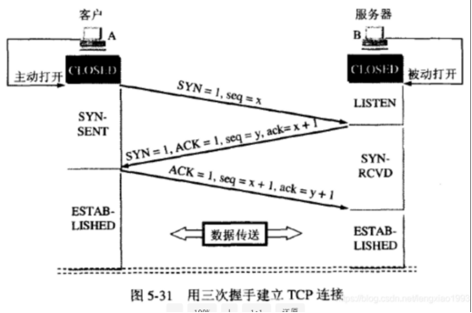
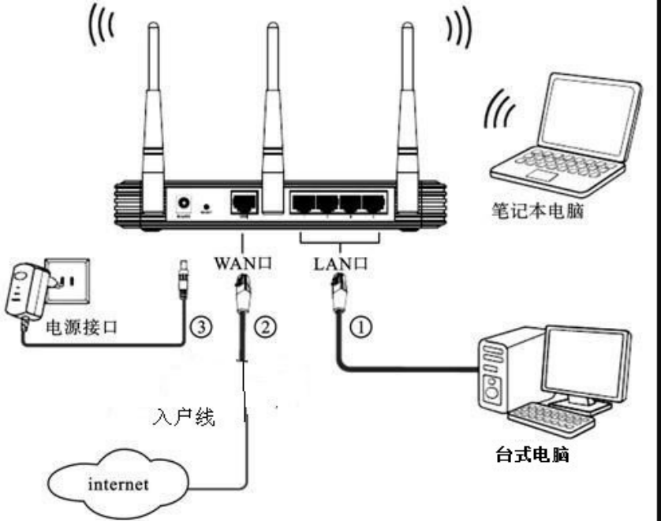
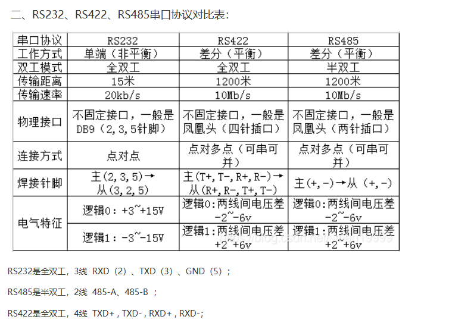
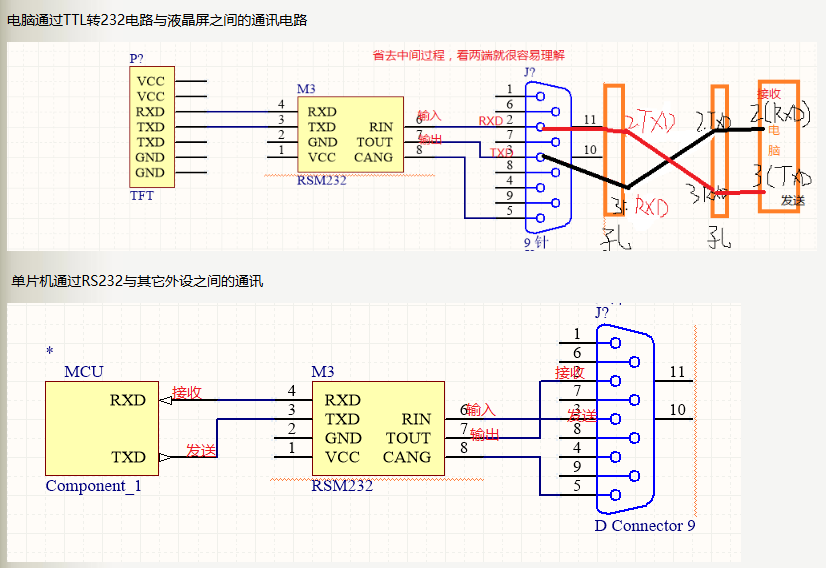
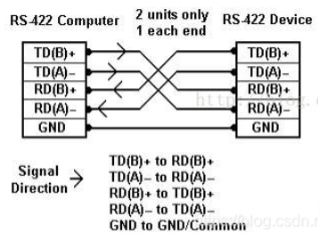
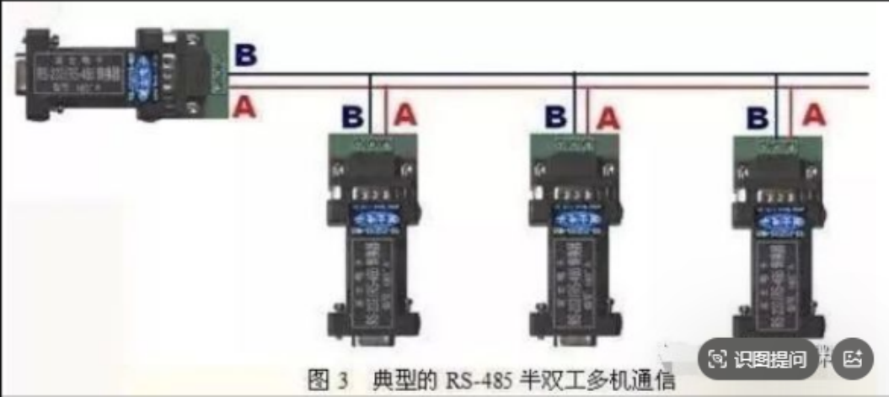

# 二进制、八进制、十进制、十六进制完整讲解

```python
二进制
BIN = Binary
英 /ˈbaɪnəri/ 美 /ˈbaɪneri/
八进制
OCT = Octal
英 /ˈɒktl/ 美 /ˈɑːktl/
十进制
DEC = Decimal
英 /ˈdesɪml/ 美 /ˈdesɪml/
十六进制
HEX = Hexadecimal
英 /ˌheksəˈdesɪml/ 美 /ˌheksəˈdesɪml/
```


## 一、基础定义（进位规则、基数、字符）

### 1. 十进制（日常用）

- 基数：**10**
- 数码：`0、1、2、3、4、5、6、7、8、9`
- 进位：**逢十进一**
  例：9+1=10

### 2. 二进制（计算机底层）

- 基数：**2**
- 数码：`0、1`
- 进位：**逢二进一**
  例：1+1=10

### 3. 八进制（简化二进制）

- 基数：**8**
- 数码：`0、1、2、3、4、5、6、7`
- 进位：**逢八进一**
  例：7+1=10

### 4. 十六进制（编程常用）

- 基数：**16**
- 数码：`0-9、A(10)、B(11)、C(12)、D(13)、E(14)、F(15)`
- 进位：**逢十六进一**
  例：F+1=10

## 二、进制快速换算关系（核心）

1位八进制 = 3位二进制
1位十六进制 = 4位二进制

### 对照表（0~15）

| 十进制 | 二进制 | 八进制 | 十六进制 |
| ------ | ------ | ------ | -------- |
| 0      | 0000   | 0      | 0        |
| 1      | 0001   | 1      | 1        |
| 2      | 0010   | 2      | 2        |
| 3      | 0011   | 3      | 3        |
| 4      | 0100   | 4      | 4        |
| 5      | 0101   | 5      | 5        |
| 6      | 0110   | 6      | 6        |
| 7      | 0111   | 7      | 7        |
| 8      | 1000   | 10     | 8        |
| 9      | 1001   | 11     | 9        |
| 10     | 1010   | 12     | A        |
| 11     | 1011   | 13     | B        |
| 12     | 1100   | 14     | C        |
| 13     | 1101   | 15     | D        |
| 14     | 1110   | 16     | E        |
| 15     | 1111   | 17     | F        |

## 三、进制互相转换方法

### （一）任意进制 → 十进制：按权展开

公式：每一位数字 × 基数^位数（从右从0开始）
示例1：二进制 `1011` 转十进制
$$1×2^3 + 0×2^2 + 1×2^1 + 1×2^0 = 8+0+2+1=11$$

示例2：十六进制 `2A` 转十进制
$$2×16^1 + 10×16^0 = 32+10=42$$

### （二）十进制 → 其他进制：除基取余，逆序输出

例：十进制11转二进制
11÷2=5 余1
5÷2=2 余1
2÷2=1 余0
1÷2=0 余1
余数倒序：`1011`

### （三）二进制 ↔ 八进制 / 十六进制（分段法，最快）

1. 二进制转八进制：**从右往左，每3位分一组，不足左边补0**
   例：`11010` → 补0 `011 010` → 3 2 → 八进制`32`

2. 二进制转十六进制：**从右往左，每4位分一组，不足左边补0**
   例：`11010` → 补0 `0001 1010` → 1 A → 十六进制`1A`

3. 八/十六进制转二进制：**一位拆三位/四位**
   例：八进制`25` → 2=010，5=101 → 二进制`010101`
   例：十六进制`B3` → B=1011，3=0011 → 二进制`10110011`

## 四、使用场景

1. **十进制**：日常生活、数学计算
2. **二进制**：计算机底层存储、CPU运算，只有0和1高低电平
3. **八进制**：早期计算机，现在很少用，仅部分底层配置
4. **十六进制**：编程（颜色码#FFFFFF、内存地址、硬件寄存器）

## 五、标识写法（区分进制）

- 二进制：数字后加B，如 `1011B`
- 八进制：数字前加0，如 `032`
- 十进制：默认不加，如 `11`
- 十六进制：数字前加0x，如 `0x1A`

需要我给你几道进制换算练习题（带答案）吗？

# TCP/IP四层模型（结合工控场景整理笔记）

> TCP/IP四层：**应用层 → 传输层 → 网络层 → 网络接口层**

## 1. 应用层

直接给软件使用，负责**业务数据交互**，把业务消息封装好交给下层。 常见协议&端口：

- HTTP/HTTPS、FTP、MQTT、DNS、SMTP
- 工控：**Modbus‑TCP(502)、OPC UA TCP(4840)**

> 工控场景：读写寄存器、心跳、上报温度、设备参数，全部在这一层。

## 2. 传输层

负责端到端的数据传输，区分端口。

### TCP

- 面向连接；传输单位：报文段
- 特性：**可靠、有序、应答确认、超时重传、校验、流量控制、拥塞控制**
- 流程：**三次握手建立连接，四次挥手断开连接**
- 工控场景：Modbus‑TCP、OPC UA，需要保证指令不丢。

### UDP

- 无连接；不可靠；速度快、开销小
- 适用：视频直播、语音、广播；工控少量高频采集场景。

## 3. 网络层

负责路由选择，跨网络寻址，依靠**IP地址**定位设备。

- 核心协议：IPv4、IPv6
- 设备：**路由器工作在网络层**
- IP核心作用
  1. 给网络设备分配唯一IP地址，如`192.168.1.100`
  2. 实现跨局域网、跨网段通信
  3. 配合**子网掩码、网关、路由**完成跨网访问

## 4. 网络接口层

等价OSI的**数据链路层 + 物理层**

- 硬件：网卡、网线、RJ45、以太网帧
- 设备：**交换机工作在此层**
- 负责把IP数据包封装成以太网帧，通过物理硬件传输。

------

# 完整通信流程实例：电脑(客户端) ↔ PLC(服务端，Modbus‑TCP)

环境：同一局域网

- 电脑：`192.168.1.20`
- PLC：`192.168.1.50` 子网掩码、网关一致，交换机/网线物理连通。

1. **网络层（IP）** IP完成寻址，找到目标PLC设备。
2. **传输层（TCP）：三次握手建立连接**

- 客户端 → 服务端：`SYN`
- 服务端 → 客户端：`SYN + ACK`
- 客户端 → 服务端：`ACK` TCP可靠通道建立完成。



1. **应用层：业务交互（Modbus‑TCP）**

- 电脑下发读寄存器报文
- PLC解析指令，读取寄存器
- PLC返回寄存器数据
- 电脑解析、展示温度/点位/参数

> MQTT、OPC UA、自定义工控协议，业务消息全部放在这一层。

1. **传输层（TCP）：四次挥手释放连接**

- 客户端发送关闭请求
- 服务端应答确认收到关闭请求
- 服务端发送本方关闭请求
- 客户端应答确认，连接释放

✅一句话串联： **IP找设备 → TCP建立可靠通道 → 应用层协议传递业务指令数据**

## 工控现场对应关系（快速对照）

| 现场操作                                 | 对应TCP/IP层级 |
| ---------------------------------------- | -------------- |
| 配置静态IP、子网掩码、网关               | 网络层         |
| 长连接、防丢包、重传逻辑                 | 传输层(TCP)    |
| Modbus‑TCP读写寄存器、心跳包、OPC UA订阅 | 应用层         |
| 网线、交换机、网卡接线                   | 网络接口层     |

## 易混小结

1. 交换机：二层，网络接口层；路由器：三层，网络层。
2. IP负责找哪一台设备；TCP负责设备之间可靠收发；应用层负责“发什么业务内容”。
3. EtherCAT/Profinet不走完整TCP/IP栈，直接封装以太网帧，跳过传输层、IP层，实现硬实时。

> 对比记忆： Modbus‑TCP / OPC UA：完整TCP/IP四层； EtherCAT / Profinet IRT：直接跑网络接口层，绕过IP+TCP，获取微秒级实时性。

需要的话我把前面所有内容（Modbus、OPC UA、EtherCAT、Profinet、TCP/IP、子网划分）合并成一份完整的工控网络速记文档。

# C类地址子网划分笔记整理

## 一、C类地址默认基础

- 默认子网掩码：`255.255.255.0` → `/24`

- 网络位：**24位**，主机位：**8位**

- 地址范围：`192.0.0.0 ~ 223.255.255.255`

- 单个网段可用主机：$2^8-2 = 254$台

  > 减2原因：扣除**网络地址**和**广播地址**，这两个IP不能分配给终端设备。
  >
  > 子网划分本质：**从主机位借若干比特，当作新的子网网络位，切割出更多小子网**。

## 二、核心公式

1. 借 `n` 位，子网数量：$\boldsymbol{2^n}$

2. 剩余主机位m,每个子网可用主机数：$\boldsymbol{2^m-2}$

   > m = 原始主机位 − 借位数量；C类原始主机位=8。

## 三、标准解题四步骤

1. **明确需求**：需要多少个子网，求需要借几位n（$2^n\ge$所需子网数）
2. **计算新掩码**：C类原始24位网络位，借n位 → 新掩码前缀：`24+n`，换算成点分十进制掩码。
3. **计算块大小（增量）**：只看第4字节 $$块大小 = 256 - 掩码第4段数值$$
4. **枚举全部子网**：以块大小为步长依次累加； 每个子网：

- 第一个IP：**子网网络地址**
- 最后一个IP：**子网广播地址**
- 中间IP：可分配给主机使用

## 四、经典例题：192.168.1.0/24，划分4个子网

1. 求借位：子网数4，$2^n=4 \Rightarrow \boldsymbol{n=2}$，借2位
2. 新掩码前缀：$(24+2=26)$ → `/26`，掩码`255.255.255.192`
3. 块大小：$256-192 = \boldsymbol{64}$
4. 全部子网：

| 子网网络地址  | 地址范围                      | 广播地址      | 可用主机IP段                  | 可用主机数量 |
| ------------- | ----------------------------- | ------------- | ----------------------------- | ------------ |
| 192.168.1.0   | 192.168.1.0 ~ 192.168.1.63    | 192.168.1.63  | 192.168.1.1 ~ 192.168.1.62    | $2^6-2=62$   |
| 192.168.1.64  | 192.168.1.64 ~ 192.168.1.127  | 192.168.1.127 | 192.168.1.65 ~ 192.168.1.126  | 62           |
| 192.168.1.128 | 192.168.1.128 ~ 192.168.1.191 | 192.168.1.191 | 192.168.1.129 ~ 192.168.1.190 | 62           |
| 192.168.1.192 | 192.168.1.192 ~ 192.168.1.255 | 192.168.1.255 | 192.168.1.193 ~ 192.168.1.254 | 62           |

## 五、常用C类子网速查表（考试/排网口直接查）

| 借位n | 子网前缀 | 子网掩码        | 块大小 | 子网数量 | 每个子网可用主机 |
| ----- | -------- | --------------- | ------ | -------- | ---------------- |
| 0     | /24      | 255.255.255.0   | 256    | 1        | 254              |
| 1     | /25      | 255.255.255.128 | 128    | 2        | 126              |
| 2     | /26      | 255.255.255.192 | 64     | 4        | 62               |
| 3     | /27      | 255.255.255.224 | 32     | 8        | 30               |
| 4     | /28      | 255.255.255.240 | 16     | 16       | 14               |
| 5     | /29      | 255.255.255.248 | 8      | 32       | 6                |
| 6     | /30      | 255.255.255.252 | 4      | 64       | 2                |

> `/30`常用在路由器互联点到点链路，刚好2个可用IP。

## 六、记忆口诀

1. 根据子网数量，确定借几位；
2. 网络位增加，主机位减少；
3. 算出块大小，步长累加写网段；
4. 网段首是网络号，末尾是广播号，中间才是可用IP。

### 易错点提醒

1. $2^n$是子网总数，实际工程中不要直接拿网络地址、广播地址配置设备；
2. C类只有第4字节参与子网划分，前3字节固定不变；
3. 前缀`/x`和点分十进制掩码要会互相转换。

如果你需要，我可以给你出2道练习题带完整解析巩固。

# WAN口和LAN口




# 一眼看懂：WAN口、LAN口 区别

## 1. 先记一句话

**WAN口 = 接外网（进网）**
**LAN口 = 接家里设备（内网）**

## 2. 通俗解释

### WAN口（广域网口）

- 作用：**接宽带进线**
  光猫网线 → 插路由器 **WAN口**
- 负责：连运营商、拨号上网、获取外网IP
- 身份：**对外的口**

### LAN口（局域网口）

- 作用：**接家里所有内网设备**
  电脑、电视、交换机、另一台路由器 都插 **LAN口**
- 负责：组建家庭局域网、给设备发内网IP
- 身份：**对内的口**

## 3. 外观怎么认

路由器背面网口：

- **单独一个口**，一般标 **WAN**、颜色和其他口不一样（比如蓝色）
  👉 就是 WAN口
- **一排4个口**，标 **LAN1/LAN2/LAN3/LAN4**
  👉 全是 LAN口

## 4. 对比表

| 接口 | 全称                      | 用途       | 连接对象                     |
| ---- | ------------------------- | ---------- | ---------------------------- |
| WAN  | Wide Area Network 广域网  | 上网入口   | 光猫、上级网络               |
| LAN  | Local Area Network 局域网 | 接本地设备 | 电脑、监控、副路由器、交换机 |

## 5. 结合你刚才两台路由器组网

1. **常规上网**
   光猫 → 主路由 **WAN口**
   电脑 → 主路由 **LAN口**

2. **两台路由要互通最简单接法**
   主路由 **LAN口** → 网线插 副路由 **LAN口**
   **副路由WAN口空着不用**，改IP、关DHCP，就能互相通信。

# 串口通讯协议：RS232，RS422，RS485

## 对比表




## RS232连接




## RS422连接




## RS232连接




## 参考资料

[硬件：RS232通讯串口线的连接问题 - 王磊wl - 博客园](https://www.cnblogs.com/wlei1293/p/8721923.html)

[串口 RS-485/RS-422 . RS-232 区别/比较/接线图 - 闻闻家文文 - 博客园](https://www.cnblogs.com/WENJIANBO/p/15687052.html)

# 串口通讯设备组网

通过有人串口服务器，将RS485或RS232的设备进行组网。

TCP 透传 Modbus RTU（网口转 485 网关），TCP 通道里直接裸传 RTU 原始报文（带 CRC），不是标准 ModbusTCP 协议。

> 参考SLD.Net10项目代码


# OPC UA / Modbus 协议

> 分层认知：**OPC UA、Modbus TCP属于应用层协议；TCP/UDP属于传输层协议**，应用层协议运行在传输层之上。

## 一、OPC UA TCP（工业4.0主流，IEC 62541）

- 定位：新一代跨平台工业通信标准
- 底层传输：TCP，面向连接，可靠有序，自带重传，适合关键工业数据
- 默认端口：`4840`，访问格式 `opc.tcp://`
- 通信模型：客户端‑服务器，支持**订阅推送**，数据变化主动上报
- 安全能力：原生TLS加密、证书认证、权限管控，支持跨网络、上云
- 数据模型：数据自描述，自带类型、单位、描述，不需要双方提前约定报文格式
- 类比：工业界的HTTPS
- 典型场景：PLC ↔ SCADA、MES、ERP、工业网关、云端对接

> ⚠️调试：OPC UA报文结构复杂，需要建立安全通道+会话，**不适合手动拼HEX调试**，使用UaExpert等专用客户端。

## 二、Modbus家族总览

Modbus是1979年诞生的经典轻量工业协议，分为：**Modbus TCP、Modbus RTU(跑在RS485串口)**

### 2.1 Modbus TCP（以太网，工控内网最常用）

- 底层传输：TCP，端口`502`
- 报文结构：7字节MBAP报文头 + Modbus PDU，TCP保证传输可靠性，**不需要CRC校验**
- 特点：只有读写线圈、寄存器简单指令，实现简单、资源占用小；**无内置加密认证，仅限内网使用**
- 设备定位：IP+端口定位设备，从站ID在MBAP头携带
- 硬件：RJ45网线，电脑自带网口，无需转换器，交换机组网，距离受网线限制100米，可光纤扩展
- 典型场景：PLC、变频器、智能仪表、网口传感器

> Modbus TCP示例报文：从站1，读寄存器地址1，读取1个寄存器
> `00 01 00 00 00 06 01 03 00 01 00 01`

- 前6字节：MBAP头；后面：功能码+寄存器地址+数量

### 2.3 Modbus RTU（运行在RS485物理总线）

> RS485是物理层电气标准（差分A/B信号线 TR+/TR‑），Modbus RTU是跑在RS485串口上的应用协议，二者不能等同。

1. 硬件：PC无原生485接口，需要**USB转RS485转换器**；接线：A接TR+，B接TR‑，可选GND共地
2. 通信：串口异步半双工，同一时刻只能收或发；靠【串口号+波特率+校验位+从站ID】定位设备；一条总线手拉手挂载多个从站（1‑247）
3. 报文：**自带CRC16校验**，无MBAP头
4. 距离：理论最大1200米；波特率越高，最大通信距离越短
5. 开发：操作串口，需要处理波特率、超时、CRC校验，稳定性弱于以太网Modbus TCP

### Modbus TCP / Modbus RTU选型口诀

- 设备带网口、远距离、多设备组网 → **Modbus TCP**
- 设备只有485端子、本地就近布线、老仪表变频器 → **RS485+Modbus RTU**

## 三、OPC UA TCP vs Modbus TCP

| 协议       | 传输层 | 端口 | 可靠性 | 安全         | 数据模型             | 常用场景                  |
| ---------- | ------ | ---- | ------ | ------------ | -------------------- | ------------------------- |
| OPC UA TCP | TCP    | 4840 | 高     | 强(TLS/证书) | 复杂，对象模型、订阅 | 跨平台、MES/ERP、云端对接 |
| Modbus TCP | TCP    | 502  | 高     | 弱，明文     | 简单，寄存器模型     | 内网PLC、仪表、变频器     |

## 四、Modbus RTU实战报文模板

> 通用配置示例：19200，8E1；从站地址默认`01`
>
> RTU CRC 永远**低字节在前，高字节在后**
>
> RTU报文格式：`从站地址 功能码 起始地址高 起始地址低 数量高 数量低 [写入数据] CRC低 CRC高`

### 常用功能码

| 功能码 | 名称                                                 | 寄存器类型 | 用途               |
| ------ | ---------------------------------------------------- | ---------- | ------------------ |
| 03     | 读保持寄存器                                         | 可读可写   | 读参数、温度、转速 |
| 04     | 读输入寄存器，输入寄存器**不能用 06/10 写**，只能读  | 只读       | 传感器模拟量采集   |
| 06     | 写单个保持寄存器                                     | 可写       | 单点参数修改       |
| 10     | 写多个保持寄存器，不能写线圈，只针对**保持寄存器**。 | 可写       | 批量写寄存器       |

### 报文样例

**03读保持寄存器：从站1，起始地址1，读1个寄存器**
下发：`01 03 00 01 00 01 D5 CA`
返回示例：`01 03 02 07 D0 XX XX`，`07D0`=十进制2000

```
01      从站地址
03      功能码
02      **后续数据字节长度**
07 D0   真正寄存器数据
XX XX   CRC16校验（低字节、高字节）
```

------

**04读输入寄存器：从站1，起始1读2个输入寄存器**
下发：`01 04 00 01 00 02 71 CB`

| 字节 | 值      | 说明                                         |
| ---- | ------- | -------------------------------------------- |
| 1    | `01`    | 从站地址 SlaveID = 1                         |
| 2    | `04`    | 功能码：读**输入寄存器**（只读，模拟量采集） |
| 3‑4  | `00 01` | 起始输入寄存器地址：**1**                    |
| 5‑6  | `00 02` | 读取寄存器数量：**2 个**                     |
| 7‑8  | `71 CB` | CRC16 校验，**低字节在前 71，高字节 CB**     |

✅ 正常应答报文格式

格式：`从站ID  04  数据字节数N  [N字节寄存器数据]  CRC低 CRC高` N = 寄存器数量 × 2，2 个寄存器 → N = 4。

示例返回：`01 04 04 12 34 56 78 XX XX`

- `01`：从站
- `04`：功能码
- `04`：后面一共 4 字节有效数据
- `12 34`：第 1 个输入寄存器值（大端）
- `56 78`：第 2 个输入寄存器值（大端）
- `XX XX`：CRC 校验

❌ 异常应答

出错时功能码变为 `0x84`（04 | 0x80），后跟 1 字节异常码，无长度字段。 例：`01 84 02 CRC CRC`，02 = 非法寄存器地址。

------

**06写单个寄存器：寄存器10写入1000**
下发：`01 06 00 0A 03 E8 69 57`，成功原样返回报文

------

**10批量写寄存器：起始地址1，写入100、200两个值**
下发：`01 10 00 01 00 02 04 00 64 00 C8 96 6F`

10 功能码成功应答**只返回前 6 个字节**，不带写入的数据，也不带长度字段

| 字节  | 值      | 含义                                                |
| ----- | ------- | --------------------------------------------------- |
| 1     | `01`    | 从站地址 SlaveID = 1                                |
| 2     | `10`    | 功能码，批量写多个保持寄存器                        |
| 3‑4   | `00 01` | **起始寄存器地址：1**                               |
| 5‑6   | `00 02` | 要写入寄存器数量：**2 个寄存器**                    |
| 7     | `04`    | 后续**数据域字节长度**，2 个寄存器 ×2 字节 = 4 字节 |
| 8‑9   | `00 64` | 第 1 个寄存器写入值：十进制 `100`                   |
| 10‑11 | `00 C8` | 第 2 个寄存器写入值：十进制 `200`                   |
| 12‑13 | `96 6F` | CRC16 校验（低字节在前`96`，高字节`6F`）            |

### 业务场景报文

- 读取温度，寄存器100：`01 03 00 64 00 01 95 0E`
- 修改设备地址，寄存器200改为2：`01 06 00 C8 00 02 89 26`
- 启动设备，寄存器50写1：`01 06 00 32 00 01 2D 0A`
- 停止设备，寄存器50写0：`01 06 00 32 00 00 6C CA`

### RTU开发调试关键点

1. 手册寄存器地址大多是**十进制**，写报文需要转为十六进制
2. 绝大多数工控设备：**大端模式，高字节在前**
3. 浮点数占用连续2个寄存器，需要做浮点数解析
4. 串口参数（波特率、数据位、校验位）必须与设备完全匹配

## 五、硬件接口对比

| 项目     | Modbus TCP               | RS485 Modbus RTU            |
| -------- | ------------------------ | --------------------------- |
| 物理接口 | RJ45网线                 | A(TR+)、B(TR‑)差分信号线    |
| PC端硬件 | 电脑自带网卡，无需转换器 | USB转RS485转换器            |
| 设备定位 | IP地址+端口              | 串口号+波特率+从站ID        |
| 通讯模式 | 全双工                   | 半双工                      |
| 组网     | 交换机，多设备组网       | 485总线手拉手并联           |
| 传输距离 | 网线100m，可光纤扩展     | 理论1200m，速率越高距离越短 |
| 开发     | Socket网络编程，库丰富   | 串口编程，需处理CRC、超时   |

> 补充：TR+/TR‑仅用于RS485总线；Modbus TCP网口设备不需要这两根线。

如果你需要，我可以再输出一份精简版，适合粘贴到技术笔记、wiki文档。

## 其它

Modbus RTU/TCP 协议报文里面的地址字段是**16 位无符号整数 (0‑65535)**，协议规范允许起始地址 = `0x0000`。

------

保持寄存器：**40001、40002、40003 …**（Modbus 传统编号，**从 1 计数**）

| 手册编号 (4xxxx) | 报文 PDU 起始地址 (放到 03/06/10 功能码报文) |
| ---------------- | -------------------------------------------- |
| 40001            | `0x0000`                                     |
| 40002            | `0x0001`                                     |
| 40003            | `0x0002`                                     |

------

Modbus 里经常提到 **MBAP 头 + PDU**（Modbus‑TCP）；Modbus‑RTU 是 **PDU + CRC 校验**。

PDU — Protocol Data Unit，协议数据单元。

# EtherNet、EtherCAT、Profinet 对比梳理

> 基础分层区分

1. **EtherNet（以太网）**：指标准以太网，属于**物理层+数据链路层**（IEEE802.3），是底层硬件基础。
2. **EtherCAT**：倍福推出，**工业实时以太网协议**，运行在以太网之上。
3. **Profinet**：西门子主导，**工业实时以太网协议**，运行在以太网之上。

> 通俗：EtherNet 就是网线、交换机这套底座；EtherCAT、Profinet 是跑在这个底座上面两套不同工业通信语言。

## 一、EtherNet 标准以太网

- 层级：IEEE802.3，物理层+数据链路层

- 硬件：普通网线、普通交换机、RJ45

- 普通TCP/IP（OPC UA、Modbus‑TCP）都跑在标准以太网之上

- 特点：通用性极强，但普通以太网本身

  没有实时保障

  ；交换机转发会带来不确定延时、抖动。

  > 普通以太网≠工业以太网；工业以太网 = 在以太网硬件基础上增加实时协议（EtherCAT/Profinet）。

## 二、EtherCAT

- 起源：Beckhoff倍福，IEC 61158标准
- 拓扑：**菊花链（串接）**为主，也支持星型；设备之间直接串，不需要普通交换机。
- 工作机制：**帧透传（on‑the‑fly）**，一个以太网报文穿过整条链路，每个从站在报文路过时读写自己的数据，报文继续往下传。
- 实时性：**极高**，周期可达 100μs 级别，抖动很小，运动控制首选（伺服、多轴联动）。
- 主从架构：**1个主站，多个从站**；主站一般是PLC/运动控制器；从站：伺服驱动器、IO模块。
- 硬件：可以标准以太网PHY；**不需要专用交换机**；普通交换机不能串EtherCAT设备。
- 报文：EtherCAT帧直接封装以太网帧，**不使用TCP/IP协议栈**。
- 典型场景：多轴运动控制、流水线、机器人、高速产线。
- 优缺点 ✅优点：速度快、周期短、硬件成本低、实时性强 ❌缺点：主从绑定，跨设备互通差；IT侧（MES/上位机）对接麻烦，一般额外跑OPCUA。

## 三、Profinet

- 起源：西门子，PI组织，IEC 61158
- 拓扑：星型，**使用工业交换机组网**，和普通以太网布线一样。
- 三种实时等级：
  1. TCP/IP标准通信：设备配置、参数读写（非实时）
  2. RT实时：工厂IO，周期ms级
  3. IRT等时实时：运动控制，高速伺服
- 架构：控制器（PLC）做控制器，IO设备、伺服做从站。
- 硬件：标准RJ45工业交换机；可以用普通交换机（RT模式），IRT需要专用Profinet交换机。
- 典型场景：西门子PLC生态、工厂IO、产线设备对接，工厂自动化主流。
- 优缺点 ✅优点：生态庞大，西门子设备兼容性好，布线组网灵活，同时支持非实时IT通信。 ❌缺点：IRT实时方案硬件成本高；整体周期下限比EtherCAT高。

## 四、关键对比表

| 项目     | 标准EtherNet(以太网)          | EtherCAT                      | Profinet                     |
| -------- | ----------------------------- | ----------------------------- | ---------------------------- |
| 协议层级 | 物理+数据链路层底座           | 工业实时以太网协议            | 工业实时以太网协议           |
| 底层硬件 | 网线、交换机                  | 以太网PHY，**不用普通交换机** | 网线，工业交换机             |
| 拓扑     | 星型                          | 菊花链为主，可星型            | 星型                         |
| 通信模型 | TCP/IP各种上层协议            | 主从，帧透传，无TCP/IP        | 控制器‑设备，RT/IRT分级实时  |
| 最小周期 | 无实时保证                    | ~100μs                        | RT：ms级；IRT可达几百μs      |
| 典型应用 | OPC UA、Modbus‑TCP，MES上位机 | 高速多轴运动控制、伺服        | 西门子产线、工厂IO、设备联网 |
| 代表厂商 | 全部                          | 倍福、汇川、台达伺服          | 西门子，大量国内设备支持     |

## 五、选型口诀

1. 做**多轴高速运动控制、机器人** → 优先 **EtherCAT**
2. 大量西门子PLC设备，工厂IO、产线组网 → 优先 **Profinet**
3. MES/SCADA/云端对接上位机，不用硬实时 → 普通以太网跑 OPC UA / Modbus‑TCP

## 六、容易混淆点

1. EtherNet ≠ EtherCAT：EtherNet是底层硬件，EtherCAT是跑在以太网硬件上的协议。
2. EtherCAT不能直接接普通交换机串设备；Profinet依靠交换机组网。
3. EtherCAT、Profinet 都是工业以太网，但二者**协议不互通**，不能直接互访，要网关转换。

## 补充：和Modbus‑TCP、OPC UA的位置关系

```
应用层：OPC UA / Modbus‑TCP │ Profinet RT │ EtherCAT
传输层：TCP/UDP              │ 直接以太网帧
底层：────────── IEEE802.3 EtherNet（以太网）──────────
```

- Modbus‑TCP、OPC UA走完整TCP/IP栈，**不做硬实时**。
- EtherCAT、Profinet RT/IRT绕过TCP/IP栈，实现工业硬实时。

如果你需要，我可以把Modbus RTU/TCP、OPC UA、EtherCAT、Profinet合成一张总对比大表，方便笔记保存。